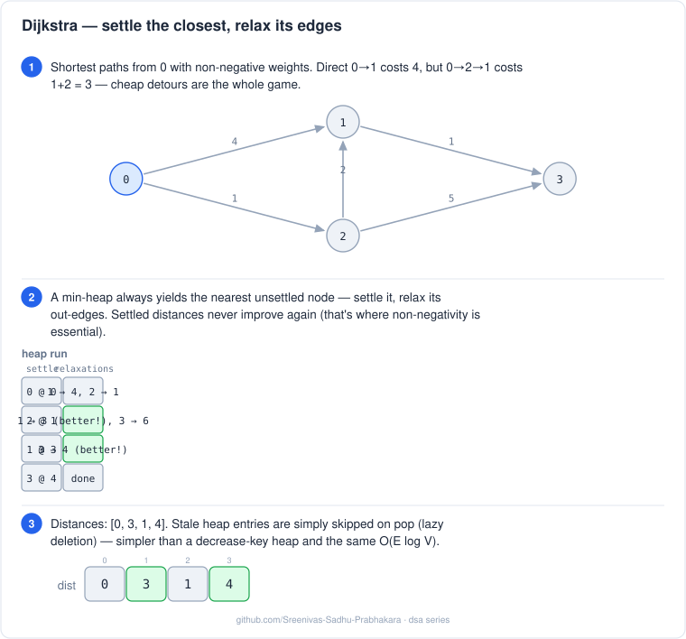

# Dijkstra's Shortest Paths

> Striver SDE Sheet 165 · Day 24 Graph II — settle vertices nearest-first from a min-heap; lazy deletion keeps the heap honest without a decrease-key. Go, stdlib only, tested.

## Problem

Single-source shortest distances in a weighted graph with **non-negative** weights — the workhorse of routing. (Negative weights void the greedy argument; that's Bellman–Ford's job, #166.)

## Approach

Greedy settling: the unsettled vertex with the smallest tentative distance can never be improved later — any other route would pass through something already at least as far, and weights can't be negative to claw that back. A min-heap serves the next-nearest vertex; relaxing its edges may push improved tentative distances. Go's `container/heap` has no decrease-key, so the standard trick is **lazy deletion**: push duplicates freely, and when popping, skip entries worse than the recorded distance (`it.dist > dist[v]`). Unreachable vertices come back as -1 rather than a magic infinity leaking into the caller.

**Complexity:** O((V+E) log V) time, O(V+E) space.

## Visual walkthrough

Read the picture top to bottom — each numbered frame is one moment of the algorithm
running on this repo's test example.

## Run

    go test ./...   # verify
    go run .        # demo

---

One of 191 repos solving Striver's SDE Sheet in Go — stdlib only, one problem per repo, every solution tested. Browse the set: [`dsa-*` repos](https://github.com/Sreenivas-Sadhu-Prabhakara?tab=repositories&q=dsa-&type=source).
